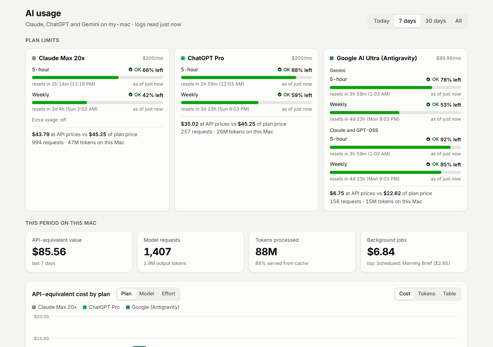
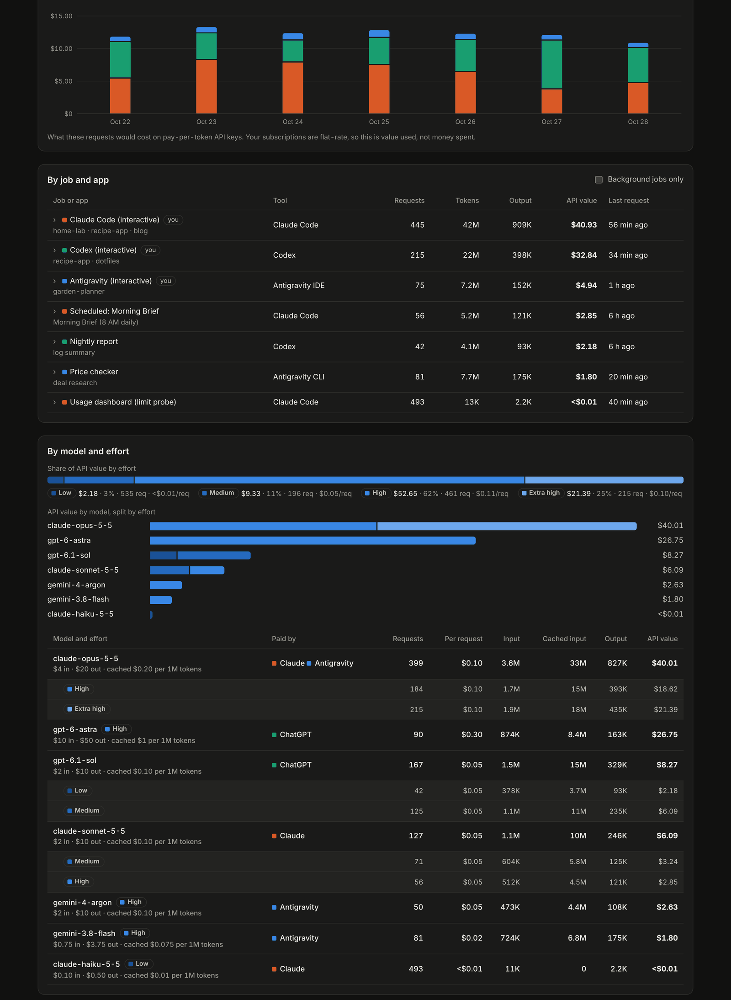

# AI Usage

A local dashboard for the Claude Code, Codex (ChatGPT) and Antigravity (Gemini) usage on your Mac:
the plan limits that matter on flat-rate subscriptions, what the same requests would cost on API
keys, and which jobs, apps, models and effort levels used them.

It runs on your Mac, reads the logs these tools already write, and sends nothing anywhere.



## What it shows

- **Plan limits**: Claude's 5-hour and weekly windows, ChatGPT's Codex limits, Antigravity's
  5-hour and weekly buckets, and how much of each is left. Limits are account-wide; usage figures
  are for this Mac only.
- **API-equivalent value**: what the same requests would cost on pay-per-token API keys, by plan,
  job, model, effort and day. On a flat-rate subscription this is value used, not money spent.
- **Jobs and apps**: scheduled tasks, background jobs and interactive sessions, each with its
  models, tokens and last request.
- **Models and effort**: cost per request for each model and reasoning effort, next to the
  providers' list prices.



## Data sources

| Source | Read from | Notes |
|---|---|---|
| Claude Code | `~/.claude/projects/**/*.jsonl` | Desktop session titles and scheduled-task ids from the Claude app's session records |
| Codex | `~/.codex/sessions` and `archived_sessions` rollouts | Per-response usage records |
| Antigravity | `~/.gemini/antigravity{,-cli}/conversations/*.db` | Protobuf blobs decoded by `ai_usage/protowire.py` |
| No-log calls | OTLP/HTTP JSON on `127.0.0.1:4318` | `claude -p --no-session-persistence` and `codex exec --ephemeral` save nothing on disk |
| Claude limits | `claude -p --output-format stream-json` | A one-word Haiku request every 20 minutes returns a `rate_limit_event` |
| ChatGPT limits | `codex app-server` | `account/rateLimits/read` every 10 minutes; no model usage |
| Antigravity limits | the running Antigravity app's `language_server` | `RetrieveUserQuotaSummary` on its loopback port every 5 minutes; `GetUserStatus` names the tier. No model usage |

None of these are official usage APIs. They are the files and local endpoints the tools use
themselves, so an update to Claude Code, Codex or Antigravity can change them. Tests cover the
formats as of October 2026.

## Privacy

- Nothing reads credentials or sign-in tokens. Each CLI uses its own sign-in.
- The Antigravity reader takes the language server's per-process CSRF token from the process list
  and sends it only back to that process's loopback port. It is never stored or logged, and the name
  and email in its replies are discarded.
- Logs are read incrementally once a minute and never modified. Prompt text is not stored; Claude Code
  and Codex redact prompts from telemetry by default.
- The page and its API answer only loopback, private-network and Tailscale addresses, and only for
  Host names it knows, so another website cannot read it through DNS rebinding. The telemetry
  receiver listens on loopback only. Don't expose either through a public tunnel.

## Requirements

macOS and Python 3.9 or later; no packages are needed. Install the CLIs you want measured
(`claude`, `codex`, Antigravity) and sign in to them as usual.

## Try it with fictional data

```sh
python3 scripts/demo.py      # http://127.0.0.1:8797
```

The demo uses a temporary folder as its home folder, so it reads none of your logs and runs no
limit checks. It works on Linux too.

## Install

```sh
git clone https://github.com/danielyaa5/ai-usage.git
cd ai-usage
python3 install.py
```

This installs and starts a LaunchAgent (`com.danielyakobian.ai-usage`) that serves the dashboard on
port 8796. Open `http://<your-mac>.local:8796` on this Mac or another device on your network or
tailnet. The first scan reads every log still on disk, which can take a minute.

The LaunchAgent runs the code in this folder, so keep the folder where it is, or run `install.py`
again after moving it.

## Configure

All configuration is optional and lives in files git ignores, so pulling updates never overwrites it.

- **`local.json`** at the repository root (copy `local.example.json`):
  - `name`: what the page calls this Mac. Defaults to its host name.
  - `allowed_hosts`: extra Host names to answer to, such as your Tailscale MagicDNS name
    (`my-mac.your-tailnet.ts.net`). `localhost`, this Mac's name and `<name>.local` are always allowed.
  - `launch_agents`: LaunchAgent label → job name, for `install.py --wire-jobs` below.
- **`ai_usage/jobs.local.json`** (copy `ai_usage/jobs.json`): rules that attribute usage to your jobs
  by telemetry attribute, first prompt or working folder. The first matching rule wins. When this file
  exists it replaces the example rules, and editing it makes the next scan read every log again so
  stored events take the new rules.
- **`ai_usage/pricing.json`**: API list prices per million tokens, and your plans. Set each plan's
  `monthly_usd` to what you pay, and add a `label` (for example `"label": "Claude Pro"`) to rename
  it on the page. It reloads on change.

## Count background jobs that leave no logs

`claude -p --no-session-persistence` and `codex exec --ephemeral` write nothing on disk. To count
them, send their telemetry to the dashboard:

```sh
python3 install.py --skip-dashboard --wire-jobs --codex
```

`--wire-jobs` adds `CLAUDE_CODE_ENABLE_TELEMETRY` and `OTEL_*` settings, including
`OTEL_RESOURCE_ATTRIBUTES=ai_usage.job=<name>`, to the LaunchAgents listed under `launch_agents` in
`local.json`. It reloads a job only when that job is not running; add `--restart-running` to restart
jobs that run continuously. `--codex` appends an `[otel]` exporter to `~/.codex/config.toml`; Codex
telemetry for sessions that also write a rollout is discarded in favor of the rollout. `--unwire`
reverses both. Every edited file is first copied to `~/Library/Application Support/ai-usage/backups/`.

Reinstalling a wired job's own LaunchAgent usually drops these settings; run `--wire-jobs` again
afterwards. Both CLIs keep working normally while the dashboard is down.

## Operate

```sh
launchctl kickstart -k gui/$(id -u)/com.danielyakobian.ai-usage   # restart
tail -f ~/Library/Logs/ai-usage.log
python3 -m unittest discover -s tests -t .
```

Data: `~/Library/Application Support/ai-usage/usage.sqlite`. Deleting it triggers a full rescan of
the logs still on disk; telemetry-only history and limit history would be lost.

The Claude limit check spends one tiny Haiku request every 20 minutes (about $0.0005 at API prices)
from your plan. Install with `python3 install.py --no-claude-probe` to turn it off; Claude's limits
then stay blank.

## License

[MIT](LICENSE)
